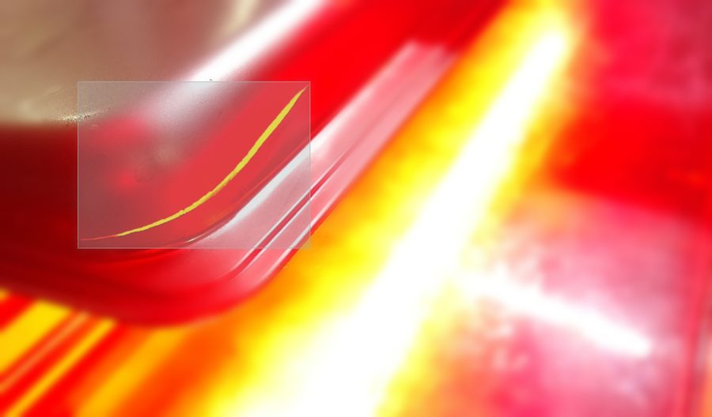
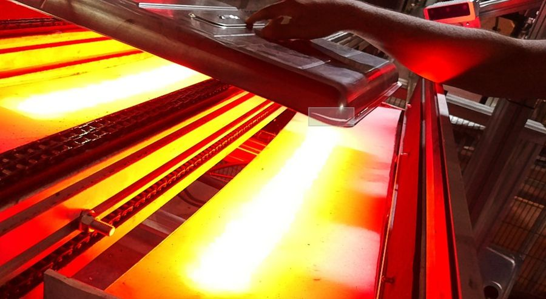
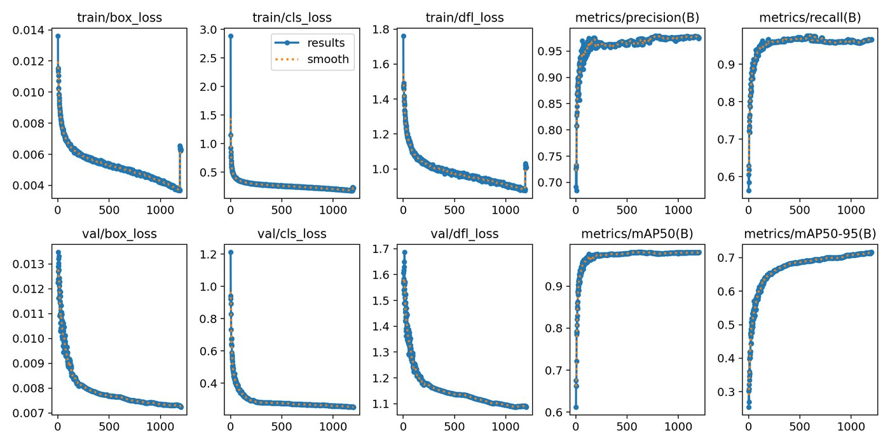
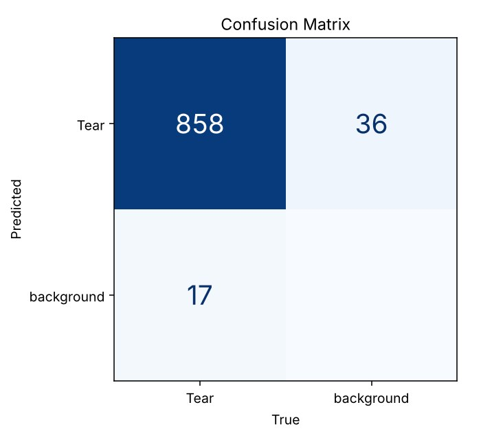
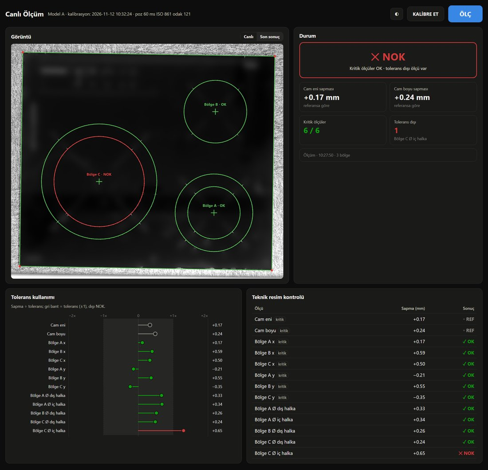
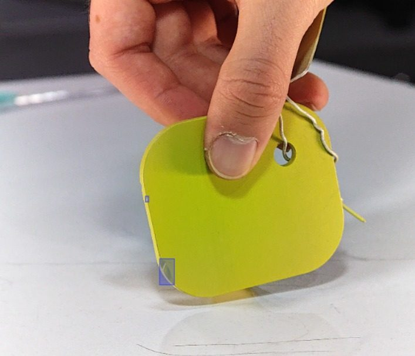
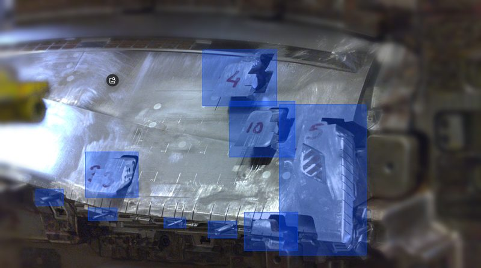
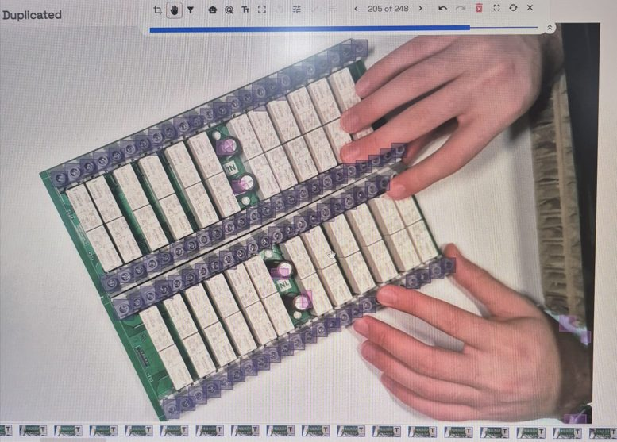

# Mustafa Sarı | Bilgisayar Mühendisliği ve Yapay Zeka

Bilgisayar mühendisliği son sınıf öğrencisiyim. Yapay zeka alanında, ağırlıklı olarak bilgisayarlı görü üzerine çalışıyorum ve Dataguess'te endüstriyel yapay zeka projelerinde yer alıyorum.

[LinkedIn](https://www.linkedin.com/in/mustafa-sar%C4%B1-2a0805286)

---

## Dataguess | Endüstriyel Yapay Zeka

Dataguess'te uzun dönem yapay zeka mühendisliği stajımı yapıyorum ve üretim hatları için görüntü işleme modelleri geliştiriyorum. Veri gizliliği nedeniyle çalışmalarımın yalnızca bazı kısımlarını paylaşıyorum.

### Pres Hattında Hata Tespiti
Sıcak pres hattından çıkan metal parçalardaki hataların tespiti için geliştirilen bir model. Veri etiketleme ve model eğitimini ben yaptım, modelin sahadaki cihazda çalıştırılmasına uzaktan destek verdim.

  
  

**Model:** YOLOv11 Nano · 1024×1024

  

  

**Sonuç:** Precision 0.97 · Recall 0.97 · mAP50 0.98 · mAP50-95 0.72

### Kamera ile Cam Panel Ölçümü
Cam panelin en ve boyunu, pişirme bölgelerinin konum ve çaplarını ölçüp teknik resimle karşılaştıran ve OK/NOK sonucu veren bir ölçüm sistemi.

  

**Yöntem:** Distorsiyon ve perspektif düzeltmesi · Parçanın kendisiyle kalibrasyon · Alt-piksel kenar tespiti · Daire uydurma

**Sonuç:** ±0.02 mm tekrarlanabilirlik · Ölçüm başına ~5 sn

**Teknolojiler:** Python · OpenCV · NumPy · DepthAI

### Diğer Örnek Çalışmalar
Farklı üretim alanlarında yer aldığım POC ve saha çalışmalarından örnekler. Bu çalışmalarda Luxonis OAK kameralarla bağlantı kurup görüntü topladım ve eğitilen modelleri kameralara deploy ettim.

  
  
  

---

## Öne Çıkan Projeler

### 1. Mutabık: Fiş OCR ve Mutabakat Sistemi
Fiş fotoğrafını OCR ile okuyup sonucu Matrah + KDV = Toplam kuralıyla doğrulayan sistem; tutmayan fişleri nedeniyle birlikte "şüpheli" işaretliyor.
* **Özellikler:** OpenCV ile ön işleme, PaddleOCR ile okuma, ödeme çapraz kontrolü, harcama paneli ve telefondan çekim için mobil PWA.
* **Sonuç:** Sentetik bozulmalı test setinde alan bazında %96–100 doğruluk, CPU'da fiş başına ortalama 2 sn. 239 otomatik test.
* **Teknolojiler:** Python, FastAPI, PaddleOCR, OpenCV, SQLite, Streamlit, Docker
* [Kaynak Kodları](https://github.com/Mustafa037/mutabik)

### 2. Otomatik Araç Plaka Tanıma Sistemi
YOLOv8 tabanlı iki aşamalı sistem: önce plaka bölgesi tespit edilip kırpılıyor, ardından ayrı bir model karakterleri tespit edip soldan sağa dizerek plaka metnini oluşturuyor.
* **Özellikler:** Plaka tespiti ve kırpma, klasik OCR yerine karakter bazlı nesne tespiti ile okuma, tek görselde birden fazla plaka desteği, tespit kutularıyla görselleştirilmiş sonuçlar.
* **Teknolojiler:** Python, YOLOv8, OpenCV, Streamlit, NumPy, Pillow
* [Kaynak Kodları](https://github.com/Mustafa037/number-plate-recognition-app)
* [Canlı Demo](https://number-plate-recognition-app-6sv7vxpkfkpk6w3pkt692l.streamlit.app/)

### 3. Dermatoskopik Görüntülerle Deri Kanseri Sınıflandırması
Yapay Sinir Ağları dersi kapsamında 4 kişilik ekiple yaptığımız proje. ISIC 2018 veri setinde YOLOv8-Cls, EfficientNet (B0–B3), MobileNetV2 ve ResNet50 mimarilerini aynı eğitim koşullarında karşılaştırdık.
* **Sonuç:** En yüksek genel doğruluk YOLOv8-Cls ile %81.15, melanomda en yüksek recall EfficientNet-B0 ile %74.26.
* **Teknolojiler:** PyTorch, YOLOv8, Scikit-Learn
* [Kaynak Kodları ve Rapor](https://github.com/Mustafa037/skin-cancer-classification-deep-learning)

## Diğer Çalışmalar

* **Diyabet Risk Tahmini:** Pima veri setinde eksik veri iyileştirmesi ve öznitelik mühendisliği (Glukoz/İnsülin oranı, BMI/yaş grupları) ile Random Forest tabanlı risk tahmini yapan Streamlit uygulaması. [Kaynak Kodları](https://github.com/Mustafa037/Diabetes-risk-prediction-app-ML) · [Canlı Demo](https://diabetes-risk-prediction-app-ml-tkfrjp7u4vewzjcj9cjkfz.streamlit.app/)
* **Machine Learning Cookbook:** Keşifsel veri analizi, regresyon, SVM, Naive Bayes ve hiperparametre optimizasyonu çalışmalarımı içeren notebook havuzu. [Notebook Havuzu](https://github.com/Mustafa037/machine-learning-exercises)

---
